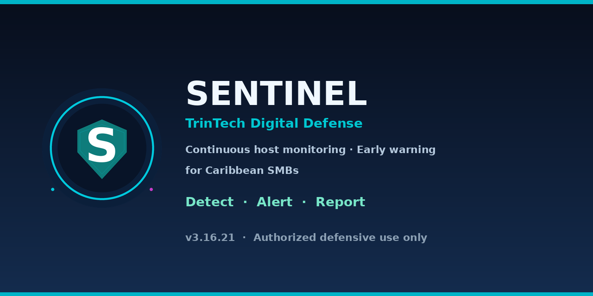

# SENTINEL

<p align="center">
  
</p>

[](https://github.com/trintechdigitaldefense/Sentinel/actions/workflows/ci.yml)
[](CHANGELOG.md)
[](LICENSE)
[](docs/RELEASE_CHECKLIST.md)

**TrinTech Digital Defense** — continuous host monitoring and early warning for Caribbean SMBs.

> **Authorized defensive use only.** Detect · Alert · Report. No offensive capability.

**Status:** pilot candidate (v3.16.21) on main — **not** a certified production release until [docs/RELEASE_CHECKLIST.md](docs/RELEASE_CHECKLIST.md) gates are evidenced and owner-approved.

## Operating model: supervised automated monitoring

Sentinel is a **supervised automated monitoring tool**. Its hunt and monitoring functions can run continuously on a designated, supported always-on host, while an authorised human operator remains responsible for reviewing alerts, validating findings, and deciding on response.

- Automated monitoring and alerting do not make an alert proof of compromise.
- Sentinel does not replace an operator, incident-response service, or staffed 24/7 SOC.
- Potentially disruptive response remains constrained by configuration and explicit approval. SSH automatic blocking is off by default; firewall changes remain dry-run until confirmed.
- A running service means the monitoring process is active; it does not guarantee that an operator is continuously available or that every third-party alert channel is reachable.
- The pilot agreement should define monitoring hours, alert recipients, review/acknowledgement targets, escalation contacts, permitted response actions, and maintenance responsibilities.

## Deployment model (SMB pilot)

**Single-sensor pilot (recommended):** install Sentinel on **one always-on device** (Linux preferred; Android/Termux acceptable for light pilots). It monitors that host deeply, discovers other devices on the LAN, and does **not** fully protect every PC unless you enroll agents.

```bash
git clone https://github.com/trintechdigitaldefense/Sentinel.git
cd Sentinel && python3 setup.py
python3 sentinel.py autosubnet          # safe local /24
python3 sentinel.py doctor
python3 sentinel.py                     # menu → 1 continuous protection
python3 sentinel.py service-status      # confirm always-on
```

**Operator supervision:** set an agreed review cadence (weekly/biweekly is a baseline for routine review, with critical alerts escalated promptly); run `doctor`, review critical alerts, check alert delivery/queue health, and confirm canaries. The service can monitor continuously, but the operator-response commitment must be defined separately.

**False positives:**  
`python3 sentinel.py suppress-add SUSPICIOUS_PROCESS "pattern"`  
`python3 sentinel.py suppress`

---

## What Sentinel does

| Capability | Implementation status | Notes |
|------------|----------------------|-------|
| FIM (baseline + check) | Implemented · tested (partial) | Mode/owner/SUID; realtime needs `inotify-tools` |
| Persistence hunting | Implemented · tested (partial) | Cron, systemd, keys, LD_PRELOAD surfaces |
| Reverse-shell / behavioral | Implemented · tested (partial) | Heuristics — not proof of compromise alone |
| Canary / deception files | Implemented | Tracked decoys; missing tracked paths alert |
| Host firewall control plane | Implemented · dry-run default | Confirm required to apply; lockout guard |
| SSH brute-force blocking | Implemented · **auto_block off by default** | Opt-in autonomy |
| Multi-channel alerts | Implemented · automated tests | Persistent finding state, delivery deduplication, quiet hours, offline retry queue |
| Critical alert persistence | Implemented · tested | Survive restarts until ACK |
| Local dashboard | Implemented · authz tests | Loopback + view-only defaults; token auth |
| Doctor / go-live | Implemented | Install-health — not a production certification |
| SIEM / Splunk HEC | Implemented · tested (partial) | Optional; disabled until configured |
| Cases / evidence packs | Implemented | Hash = post-export integrity, not legal CoC alone — see [docs/EVIDENCE_HASH.md](docs/EVIDENCE_HASH.md) |
| MSP central / agent keys | Implemented | Requires correct module load; see audit |

**Alert delivery reliability (PR #9):** unchanged active findings are tracked separately from trusted detection baselines. Finding state is written atomically with restrictive file permissions and thread/process locking. Alert delivery attempts are serialized per fingerprint; failed or unconfirmed deliveries are not treated as handled. Confirmed offline-queue entries can be retried by the hunt-cycle maintenance path. This reduces duplicate notifications and avoids silently losing retryable alerts; it does not prove that a third-party channel is reachable or that a human received an alert.

Labels mean: code is present and exercised in automated tests where noted. They do **not** mean exhaustive detection coverage or field validation on your network.

---

## Architecture (host)

```
Client host
  ├─ sentinel.py          menu + CLI + hunt orchestration
  ├─ modules/             detection, firewall, alerts, dashboard, cases
  ├─ ~/.sentinel/config.json   (mode 0600 when written by setup)
  └─ ~/.sentinel/data/    baselines, canaries, queues, critical store
```

Optional: systemd service, local dashboard (default `127.0.0.1`), MSP central.

---

## Install (safe path)

```bash
git clone https://github.com/trintechdigitaldefense/Sentinel.git
cd Sentinel
python3 setup.py
python3 sentinel.py doctor
```

Or:

```bash
bash install.sh
```

**Defaults are non-destructive.** `install.sh` / `setup.py` fast-forward only.  
Destructive recovery (discards uncommitted work) only when you set:

```bash
SENTINEL_RECOVER_SYNC=1 bash install.sh
```

Optional realtime FIM:

```bash
sudo apt-get install -y inotify-tools
```

Always-on (Linux with systemd):

```bash
python3 sentinel.py service-install
python3 sentinel.py doctor
```

Supported: **Python 3.10+**, Linux (primary). Termux/Android containers may lack `/proc` net or systemd — doctor will WARN.

---

## Daily use

| Command | Purpose |
|---------|---------|
| `python3 sentinel.py` | Interactive numbered menu |
| `python3 sentinel.py start` | One scan + continuous hunt |
| `python3 sentinel.py hunt` | Hunt loop only |
| `python3 sentinel.py doctor` | Health / config checks |
| `python3 sentinel.py go-live` | Baselines + canaries bootstrap |
| `python3 sentinel.py deception` | Deploy decoys |
| `python3 sentinel.py integrity` | FIM baseline |
| `python3 sentinel.py dashboard` | Local UI (token URL printed) |
| `python3 sentinel.py monitor` | Real-time threat poll (CLI) |
| `python3 sentinel.py service-install` | Background/service install |

---

## Security defaults (current)

| Control | Default |
|---------|---------|
| SSH `auto_block` | **false** (opt-in) |
| Firewall apply | **dry-run** until confirmed |
| Dashboard bind | **127.0.0.1** |
| Dashboard `allow_control` | **false** (viewer) |
| Config file mode | **0600** on write |
| Self-integrity baseline | **0600**, atomic write |

Dashboard: shareable token **cannot enable** controls; set `dashboard.allow_control: true` on the host if operators need actions.

Report vulnerabilities privately: see [SECURITY.md](SECURITY.md).

---

## Testing

```bash
pip install -r requirements.txt ruff pytest
pytest -q tests/
bash -n install.sh
python scripts/firewall_smoke.py
```

Details: [docs/TESTING.md](docs/TESTING.md).  
CI runs compile-all, future-import guard, ruff, firewall smoke, pytest on PRs to `main`.

**Latest dashboard security verification (PR #23, 2026-11-21):** GitHub Actions passed on the PR head with **347 tests on Python 3.10 and 347 on Python 3.12**. PR #23 adds/strengthens Origin and Host validation for cookie-authenticated state-changing requests and browser regression coverage. This is PR-head CI evidence; it is not a post-merge CI result, live deployment validation, or production certification.

**Earlier PDF-serving verification (PR #21, 2026-11-20):** 310 passed, 1 skipped in the full local suite; Python 3.10 and 3.12 GitHub Actions checks passed on the PR commit. This covers PDF path, file, and directory symlink handling. It is historical PR-head evidence, not a current-main test result.

Earlier post-merge verification on `main` at `e80c09b` (2026-11-17): `python3 -m pytest -q` → **242 passed**, with one ReportLab/Python deprecation warning, on Python 3.12. GitHub Actions for PR #9 also passed on Python 3.10 and 3.12. These are historical automated checks; they are not live firewall, SIEM, WhatsApp, or customer-host validation.

---

## Documentation

| Doc | Purpose |
|-----|---------|
| [INSTALL.md](INSTALL.md) | Install, upgrade, recovery |
| [docs/SECURITY_AUDIT.md](docs/SECURITY_AUDIT.md) | Findings register |
| [docs/RELEASE_CHECKLIST.md](docs/RELEASE_CHECKLIST.md) | Release gates |
| [docs/FEATURE_INVENTORY.md](docs/FEATURE_INVENTORY.md) | Capability inventory |
| [docs/THREAT_MODEL.md](docs/THREAT_MODEL.md) | Threat model |
| [docs/EVIDENCE_HASH.md](docs/EVIDENCE_HASH.md) | What evidence hashes prove |
| [CHANGELOG.md](CHANGELOG.md) | User-visible changes |
| [docs/SALES_PACK.md](docs/SALES_PACK.md) | Pilot sales materials |

---

## Known limitations

- Heuristic detections (shells, entropy tripwires) can false-positive; treat as leads, not verdicts.
- Realtime FIM is reduced without `inotifywait` (`visibility_status().incomplete`).
- Query-string dashboard tokens can leak via logs/Referer (prefer Bearer; tracked as H-04).
- Live firewall **apply** and third-party SIEM delivery are not fully exercised in CI.
- Dashboard Origin/Host validation, atomic runtime configuration writes, loopback/TLS configuration guards, and nonce-based CSP hardening have implementation merged through PRs [#19](https://github.com/trintechdigitaldefense/Sentinel/pull/19) and [#23](https://github.com/trintechdigitaldefense/Sentinel/pull/23). Tracking issues [#15](https://github.com/trintechdigitaldefense/Sentinel/issues/15)–[#18](https://github.com/trintechdigitaldefense/Sentinel/issues/18) remain open pending independent review and completion of their acceptance evidence; do not treat them as closed.
- Actual remote TLS reverse-proxy, certificate, cookie, and network-exposure configuration must be verified on the target host before remote dashboard access is enabled.
- Post-merge CI on the exact current `main` commit, live firewall apply, real third-party alert delivery/receipt, restart/power-loss recovery, and detection coverage/false-positive rates are not established by PR-head CI.
- Doctor “install OK” is **not** a production certification.

---

## License

Authorized defensive use only — **TrinTech Digital Defense**. See [LICENSE](LICENSE).
